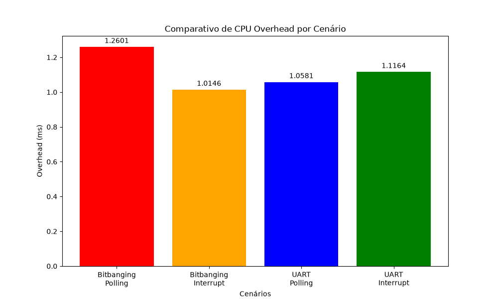

# Controlador UART em Portas Lógicas: Análise de Overhead de CPU

Este repositório contém os códigos-fonte (firmware e scripts de análise) desenvolvidos para o projeto "Controlador UART em Portas Lógicas: Impacto de Hardware Dedicado e Interrupções no Overhead de CPU". O projeto integra conceitos das disciplinas de Arquitetura de Computadores e Sistemas Digitais.

O objetivo principal é quantificar e comparar o *overhead* de processamento (medido em tempo de execução - ms) em diferentes abordagens de comunicação serial: transmissão por software (*bit-banging*) versus hardware dedicado (UART), combinadas com modelos de atendimento por espera ativa (*polling*) versus interrupções.

## Autores
* Alisson Silva
* Ariel Liotto Angonese
* Emanuel Júlio Solivo
* Márcio Dal Pizzol Júnior

## Estrutura do Repositório

O projeto está organizado da seguinte forma:

```text
hybrid-uart-cpu-overhead/
├── docs/
│   ├── Article.pdf                 # Artigo acadêmico detalhando a fundamentação e metodologia
│   └── grafico_comparativo.png     # Gráfico de resultados (em milissegundos)
├── firmware/
│   ├── analise.py                  # Script Python para leitura de CSVs e geração de gráficos
│   ├── scenario1_bitbanging_polling/
│   ├── scenario2_bitbanging_interruption/
│   ├── scenario3_uart_polling/
│   └── scenario4_uart_interruption/
└── README.md
````
## Cenários Experimentais

O experimento é composto por quatro cenários independentes implementados em linguagem C++ para o microcontrolador ATmega328P (Arduino UNO). Todos os testes operam sob condições controladas com uma taxa de transmissão padronizada de 9600 *bauds*.

Os cenários avaliados são:

1. **Cenário 1 (Bit-banging + Polling):** 
   * **Abordagem:** Transmissão serial gerada integralmente por software.
   * **Comportamento da CPU:** A CPU fica travada em um laço de espera ativa (utilizando `delayMicroseconds()`) durante a montagem e o envio de cada bit do quadro (start, dados e stop).

2. **Cenário 2 (Bit-banging + Interrupção):** 
   * **Abordagem:** Transmissão por software orquestrada por temporizador.
   * **Comportamento da CPU:** Utiliza o `Timer2` em modo de comparação (CTC) para disparar rotinas de interrupção no tempo exato de cada bit. A CPU fica livre para outras tarefas entre os disparos.

3. **Cenário 3 (UART + Polling):** 
   * **Abordagem:** Transmissão delegada ao hardware dedicado (periférico UART interno).
   * **Comportamento da CPU:** A CPU apenas carrega o byte no registrador de dados (`UDR0`) e entra em um laço de verificação contínua, consultando o registrador de status até que o hardware sinalize o fim da transmissão.

4. **Cenário 4 (UART + Interrupção):** 
   * **Abordagem:** Delegação total ao hardware com notificação assíncrona.
   * **Comportamento da CPU:** A CPU instrui o hardware a enviar o dado e é imediatamente liberada. A conclusão do envio é notificada exclusivamente através de uma interrupção de hardware nativa da UART.

**Metodologia de Medição:**  
Em todos os cenários, o *overhead* (tempo gasto pela CPU focado exclusivamente na comunicação) é capturado configurando o `Timer1` do ATmega328P em modo de contagem livre sem *prescaler*. Dessa forma, 1 incremento do temporizador equivale exatamente a 1 ciclo de *clock* da CPU (16 MHz), garantindo precisão absoluta antes da conversão dos dados para milissegundos.

## Resultados Preliminares

Os dados brutos extraídos do microcontrolador foram compilados e analisados através do script `analise.py` (utilizando as bibliotecas `pandas` e `matplotlib`). Para facilitar a comparação com sistemas reais, o *overhead* originalmente medido em ciclos de *clock* (16 MHz) foi convertido para o tempo absoluto de execução em milissegundos (ms) dividindo os valores por 16.000.

O gráfico abaixo ilustra a média de tempo de processamento em que a CPU esteve ocupada para transmitir a informação em cada um dos quatro cenários:



**Resumo dos Valores Médios (ms):**
* **Bit-banging + Polling:** 1,2601 ms
* **Bit-banging + Interrupção:** 1,0146 ms
* **UART + Polling:** 1,0581 ms
* **UART + Interrupção:** 1,1164 ms

*Observação analítica preliminar:*  
De forma contraintuitiva face à expectativa inicial, o cenário de **bit-banging com interrupção** apresentou o menor *overhead* médio (1,0146 ms) e a menor variabilidade. Este comportamento é atribuído à natureza determinística da geração de temporização através do `Timer2` em modo de comparação (CTC), cujo intervalo de disparo é fixado por *hardware*. Em contrapartida, o cenário de bit-banging com *polling* (1,2601 ms) obteve o pior desempenho, visto que utiliza a função de *software* `delayMicroseconds()`, forçando a CPU a uma espera ativa constante que introduz uma maior perda de ciclos úteis de processamento.

## Como Executar

### 1. Recolha de Dados (Microcontrolador)
Para replicar os testes e extrair os dados da CPU:
1. Abra o ficheiro `.ino` do cenário pretendido (ex: `firmware/scenario1_bitbanging_polling/scenario1_bitbanging_polling.ino`) na Arduino IDE.
2. Faça o *upload* do código para a sua placa Arduino UNO.
3. Abra o **Monitor Serial** (certifique-se de que o *baud rate* está configurado para 9600) e aguarde a conclusão das 50 transmissões.
4. Copie a saída de dados gerada e guarde-a num ficheiro `.csv` correspondente ao cenário, dentro da pasta `firmware/`. 
   * **Atenção:** Garanta que a primeira linha do ficheiro contém estritamente o cabeçalho: `byte_enviado,ciclos_overhead`.

### 2. Análise de Dados (Python)
Para processar os ficheiros CSV e gerar o gráfico comparativo, certifique-se de que tem o Python instalado no seu sistema, juntamente com as bibliotecas necessárias.

Para instalar as dependências, execute o seguinte comando no terminal:
```bash
pip install pandas matplotlib
cd [CAMINHO ATÉ A PASTA "firmware"]
py analise.py
```
